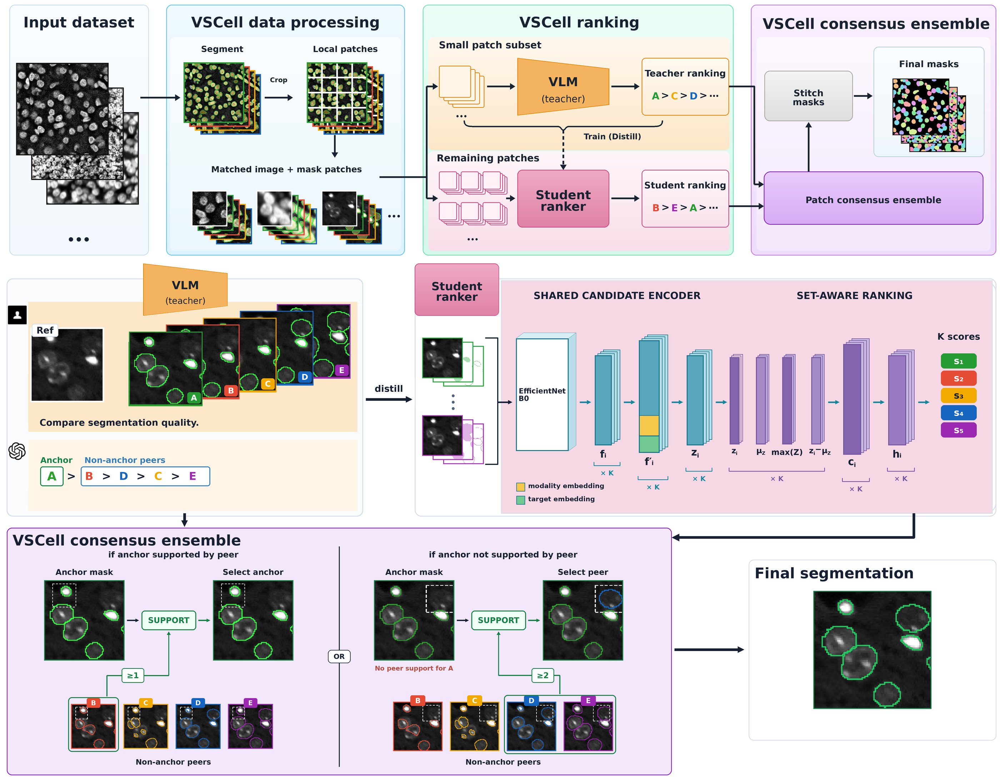
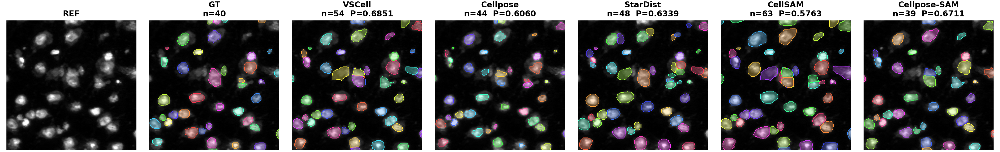

# VSCell

VSCell creates full-image instance-segmentation masks by ranking and combining
candidate masks from multiple segmentation models. A hosted vision-language
model (VLM), or an optional distilled student ranker, chooses among anonymous
candidate overlays; VSCell then applies its GT-free consensus method and
stitches the local results into one globally labelled mask.

Segmentation ground truth is never required at inference time. Segmentation
models run once on each full image, not once per crop.

> Development status: pre-release (`0.1.0.dev0`). Raw validation image files,
> third-party weights, credentials, and runtime outputs are not redistributed.
> The five approved rendered CellBinDB display panels are documented below.

## How VSCell works

VSCell starts with one full-image mask from each candidate segmentation model.
It matches each image with its candidate-mask overlays, makes local patches, and
asks a hosted VLM to rank an anonymized subset. An optional distilled student
ranker extends those rankings to the remaining patches. The GT-free consensus
module then reconciles candidate instances and stitches the patch results into
one full-image labelled mask.



*VSCell workflow. The VLM teacher, optional student ranker, and consensus
ensemble operate on image-and-candidate-mask patches; segmentation ground truth
is not accepted or used during inference.*

## Quick start

Python 3.10 or newer is required. From the repository root, create a lightweight
environment with the client for the VLM provider you intend to use:

```bash
python -m venv .venv
source .venv/bin/activate
python -m pip install -e '.[vlm-openai]'
```

For Claude, use `.[vlm-anthropic]`. Add `student` only when training or running
the student ranker, for example `.[vlm-openai,student]`.

Create a project directory and add your microscopy images:

```bash
mkdir my_vscell_project
cd my_vscell_project
mkdir data
# Copy source images into data/ before continuing.
vscell run
```

`vscell run` is the recommended interface. Its standard guided path asks for
the image path, segmentation target, modality, candidate-mask source, ranking
quality/cost profile, hosted VLM, and local or Slurm execution. Existing
candidate-model folders are detected automatically. Expert controls such as
teacher fraction, student settings, and concurrency are available through the
interactive `advanced` profile or command-line flags. VSCell shows a complete
summary and starts nothing until the user confirms it.

### Interactive and batch modes

Run `vscell run` without `--non-interactive` for the guided terminal wizard.
It asks for the settings one at a time and shows the complete run and cost
summary before it sends hosted-VLM requests or submits Slurm jobs.

For a reproducible batch or HPC run, supply the same choices as command-line
flags and add `--non-interactive`. This is not a spreadsheet or a separate
workflow: it is the same pipeline with its settings recorded in a command that
can be saved in a Bash or Slurm script. Add `--yes` only when the displayed
summary has already been reviewed.

```bash
vscell run \
  --input data \
  --output run \
  --target nuclear \
  --modality DAPI \
  --candidate-source existing \
  --teacher-fraction 0.5 \
  --vlm-model gpt-5.5 \
  --non-interactive --yes
```

For every prompt and execution path, see the
[complete user guide](docs/USER_GUIDE.md).

## Example results

Five curated CellBinDB crops show the reference image, held-out GT overlay,
VSCell output, and all four candidate models before installation. GT is used
only for this retrospective comparison—not by the VSCell workflow. Four of the
five selected crops beat their own best single candidate model; the remaining
DAPI crop is a close comparison (−0.0090). See the full
[example-results gallery](examples/example_results/) and the individual
per-method visual crops.



## What VSCell does

1. Uses existing full-image candidate masks or runs four built-in segmentation
   backends: Cellpose, StarDist, CellSAM, and Cellpose-SAM.
2. Divides each image into adaptive, padded crops.
3. Renders anonymous candidate overlays for each crop.
4. Ranks a user-selected fraction of crops three times with GPT-5.5, GPT-6
   Astra, or Claude Fable 5.1 and combines the rankings by Borda score.
5. Optionally trains a student ranker and predicts rankings for the remaining
   crops.
6. Applies the GT-free Solution 08 consensus and boundary refinement.
7. Stitches the selected instances into a full-image labelled mask and writes a
   complete decision audit.

VSCell automatically fills the prompt target wording, determines candidate
count `N`, anonymizes candidates, and generates the strict ranking format. The
user never edits `<TARGET>`, `<N>`, candidate labels, or prompt templates.

## Prepare input data

VSCell accepts a single image or a non-recursive directory containing `.tif`,
`.tiff`, `.png`, `.jpg`, `.jpeg`, or `.bmp` images. Input must be 2-D grayscale
or channels-last RGB/RGBA. TIFF is recommended for lossless microscopy data.

Do not put ground-truth masks, candidate masks, or unrelated images in `data/`.
One target and modality apply to the entire run, so heterogeneous modalities
should be organized and run separately.

### Start with raw images only

```text
my_vscell_project/
└── data/
    ├── image01.tif
    └── image02.tif
```

Select `slurm` when `vscell run` asks how to obtain candidate masks. VSCell will
submit the four built-in segmentation backends, each operating once on every
full image. Their isolated environments must be created first. Run these
commands from the VSCell source root, not from the data-project directory:

```bash
conda env create -f envs/cellpose.yml
conda env create -f envs/cpsam-cellsam.yml
conda env create -f envs/stardist.yml
```

The environment files are included in the repository and source distribution.
CellSAM requires official weight access through DeepCell, or an authorized
local weight supplied with `VSCELL_CELLSAM_MODEL_PATH`. VSCell does not bundle
third-party weights.

### Start with existing candidate masks

Provide masks from at least three models, with one mask per source image:

```text
my_vscell_project/
├── data/
│   ├── image01.tif
│   └── image02.tif
└── segmentation_results/
    ├── cellpose/
    │   ├── image01_masks.tif
    │   └── image02_masks.tif
    ├── stardist/
    │   ├── image01_masks.tif
    │   └── image02_masks.tif
    └── my_model/
        ├── image01_masks.tif
        └── image02_masks.tif
```

Each candidate must be a 2-D integer instance-label TIFF matching the source
image height and width. Use `0` for background and a positive integer for each
instance. A ready-to-copy empty layout is available in
`examples/project_template/`.

## Targets and modalities

| Target | Built-in modality descriptions |
|---|---|
| Nuclear | DAPI, ssDNA, H&E |
| Whole-cell | mIF, phase contrast, fluorescence, brightfield, DIC |

Choose `custom` for another or multimodal acquisition and provide a short name
and a plain-language description of its appearance and segmentation-relevant
signals. If a built-in modality conflicts with the selected target, VSCell
stops before any hosted call unless an explicit custom description is supplied.

DAPI and H&E raw-image-only runs can use all four built-in backends. H&E uses
its validated H&E preprocessing/model route; DAPI uses the nuclear-fluorescence
route. Backend-specific limitations are documented in the
[user guide](docs/USER_GUIDE.md#installation).

## Hosted ranking and the student

Supported hosted model identifiers are:

- `gpt-5.5` — default OpenAI model;
- `gpt-6-astra` — OpenAI alternative; and
- `claude-fable-5-1` — Anthropic alternative.

The provider account must have access to the selected model.

The teacher fraction is the proportion of image patches ranked by the hosted
VLM, not the proportion of source images. If a run contains `P` patches and the
fraction is `f`, the hosted-call count is:

```text
3 × round(P × f)
```

With fraction `1`, every patch is hosted-ranked and no student is used. With a
fraction between `0` and `1`, VSCell can submit a monitored one-GPU Slurm job to
train the student and rank the remaining patches. Fraction `0` requires an
existing compatible student checkpoint. See
[Hosted-VLM teacher fraction](docs/USER_GUIDE.md#hosted-vlm-teacher-fraction)
for the training constraints and examples.

## API keys and privacy

Immediately before hosted inference, VSCell either requests the provider key
through hidden input or reports that the corresponding environment variable is
already present. It never displays the value.

If an earlier shell exported a key, VSCell reuses it and does not prompt. To
guarantee that a new user enters their own credential:

```bash
unset OPENAI_API_KEY ANTHROPIC_API_KEY
vscell run
```

A key entered through the hidden prompt is temporary. Provider keys are not
written to workflow state, generated Slurm scripts, logs, wheels, or source
archives. Never commit a key or paste it into a command, script, log, issue, or
configuration file.

Hosted ranking sends source-image crops, anonymous candidate panels, and the
generated target/modality instructions to the selected provider. Local paths,
login names, Slurm accounts, and partition names are not placed in the VLM
request. Local workflow state and Slurm scripts do contain paths and cluster
settings needed to resume execution, so runtime directories should not be
published.

## Execution and outputs

On Slurm, the guided command monitors candidate generation, hosted ranking, and
optional student training. It reports progress and automatically continues to
consensus and stitching. Add `--detach` only when you intentionally want the
terminal to return after submission; resume later with:

```bash
vscell run --output run --resume
```

Primary outputs are under `run/workspace/`:

- `teacher_rankings.jsonl` and, for mixed runs, `all_rankings.jsonl`;
- `vscell_patch_masks/*.tif`;
- `final_masks/*_vscell.tif`, with globally assigned instance labels; and
- `final_audit.json`, containing rankings, selector and stitch decisions,
  configuration, and confirmation that segmentation GT was not used.

Accuracy is not reported during inference because ground truth is not accepted
by the workflow. Accuracy evaluation remains a separate held-out analysis.

## Documentation

- [Complete user guide](docs/USER_GUIDE.md) — detailed installation, every
  guided prompt, data validation, Slurm behavior, student training, manual
  commands, scientific defaults, and troubleshooting context.
- [Method and code provenance](docs/PROVENANCE.md) — mapping from validated
  experiments to packaged modules and intentional integration changes.
- [Validation record](docs/VALIDATION.md) — automated tests and end-to-end
  package checks.
- [Third-party notices](THIRD_PARTY_NOTICES.md) — upstream software, model,
  weight, dataset, and hosted-service terms.

## License and tests

VSCell's integration code is MIT-licensed. Dependencies, model weights,
datasets, and hosted APIs retain their own terms.

Run the package tests with:

```bash
python -m pytest
```

The release sanity suite contains 44 tests covering the guided workflow,
credential lifecycle, modality and provider routing, the four backend adapters,
concurrent ranking, student orchestration, consensus, stitching, and package
invariants.
