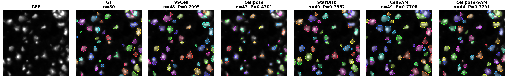
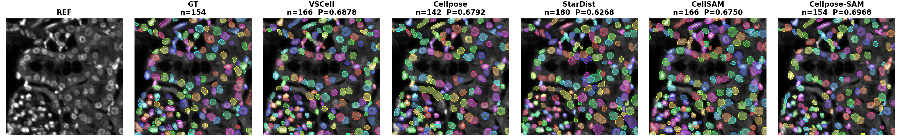
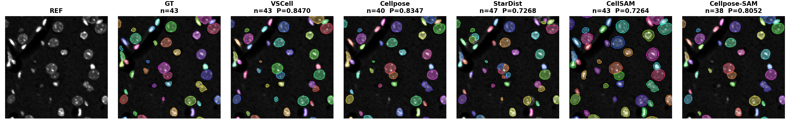
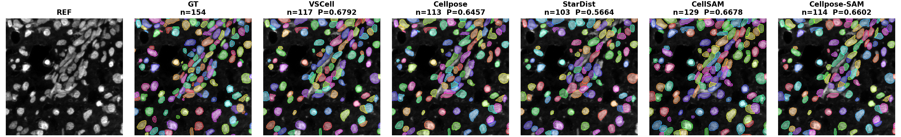

# Curated example results

These five 256×256 CellBinDB crops let a visitor inspect the input image,
ground-truth annotation, VSCell output, and each candidate model before running
VSCell. They are static display assets, not inputs to the package. The raw
reference image is shown in `reference/`; every other directory contains that
same reference with a colorized instance-overlay for the named result.

`comparison/` contains the compact seven-panel versions used below. The
individual display crops are organized by result source:

```text
comparison/     # REF, GT, VSCell, and four candidate models in one panel
reference/      # reference microscopy crop
ground_truth/   # annotation overlay, evaluation only
vscell/         # VSCell final stitched output
cellpose/       # Cellpose candidate
stardist/       # StarDist candidate
cellsam/        # CellSAM candidate
cellpose_sam/   # Cellpose-SAM candidate
```

The displayed score is the post-hoc held-out metric
`P = (F1@0.50 + mean matched-cell IoU) / 2`. Ground truth was **not** supplied
to any VSCell inference, ranking, consensus, or stitching step; it was used
only after inference to prepare this visual comparison. These selected examples
are illustrative, not an aggregate benchmark or a claim that VSCell always
outperforms every individual candidate model.

| Crop | Modality | VSCell P | Per-image best single model | Delta |
|---|---|---:|---:|---:|
| W4 | ssDNA | 0.6851 | Cellpose-SAM, 0.6711 | +0.0140 |
| X5 | ssDNA | 0.7995 | Cellpose-SAM, 0.7791 | +0.0204 |
| Y96476U4 | DAPI | 0.6878 | Cellpose-SAM, 0.6968 | -0.0090 |
| Y96476V7 | DAPI | 0.8470 | Cellpose, 0.8347 | +0.0123 |
| liver | DAPI | 0.6792 | CellSAM, 0.6678 | +0.0114 |

## ssDNA W4


## ssDNA X5



## DAPI Y96476U4



## DAPI Y96476V7



## DAPI liver



## Data reference

These approved CellBinDB-derived display crops and annotations should be cited
as: Shi C, Fan J, Deng Z, *et al.* CellBinDB: a large-scale multimodal
annotated dataset for cell segmentation with benchmarking of universal models.
*GigaScience*. 2025;14:giaf069.
[https://doi.org/10.1093/gigascience/giaf069](https://doi.org/10.1093/gigascience/giaf069)
