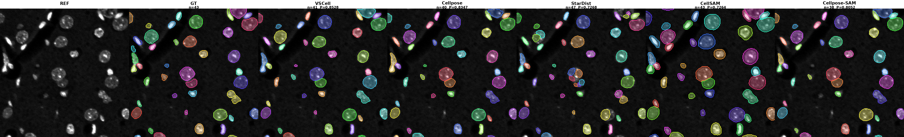
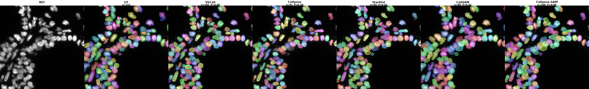
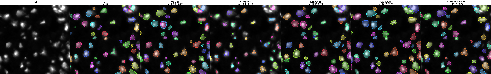
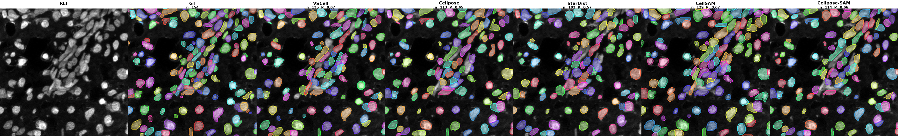

# Example results

These four 256×256 CellBinDB display crops let visitors inspect the reference
image, held-out ground-truth overlay, VSCell output, and each candidate model.
They are static display assets, not package inputs. Ground truth is used only
after inference to compute the displayed evaluation metric; it is not used for
crop planning, ranking, consensus, or stitching.

`comparison/` contains seven-panel summaries. The individual display crops are
organized by result source:

```text
comparison/     # REF, GT, VSCell, and four candidate models in one panel
reference/      # reference microscopy crop
ground_truth/   # annotation overlay, evaluation only
vscell/         # VSCell final stitched output
cellpose/       # Cellpose candidate
stardist/       # StarDist candidate
cellsam/        # CellSAM candidate
cellpose_sam/   # Cellpose-SAM candidate
```

The displayed score is the post-hoc held-out metric
`P = (F1@0.50 + average matched-cell IoU) / 2`.

## DAPI Y96476V7 (7516, 10406)



## DAPI prostate (9465, 7872)



## ssDNA X5 (15842, 7830)



## DAPI liver (14224, 6778)



## Data reference

These approved CellBinDB-derived display crops and annotations should be cited
as: Shi C, Fan J, Deng Z, *et al.* CellBinDB: a large-scale multimodal
annotated dataset for cell segmentation with benchmarking of universal models.
*GigaScience*. 2025;14:giaf069.
[https://doi.org/10.1093/gigascience/giaf069](https://doi.org/10.1093/gigascience/giaf069)
